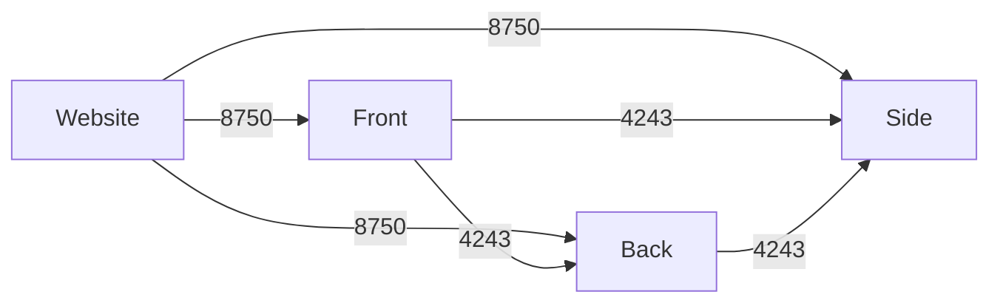

How to build a private [WireGuard](https://www.wireguard.com/) network for two kinds of traffic: the Reticulum Backbone links between your rettui nodes, and the website's link to each node's management port. Each node is its own WireGuard server, and every host that needs to reach it is a client of that server. There is no hub, and nothing is routed through a third host.

This page is for people who run the website and their own nodes. When it is done, go on to [Connecting Nodes](Connecting-Nodes).

## The example

Four hosts: the website, and three rettui nodes called Front, Back and Side, each run in Docker with `command: node`.

- Front is the public entry point (TCP 4242).
- The nodes link to each other with Reticulum Backbone (TCP) interfaces on port 4243: Front dials Back and Side, and Back dials Side.
- The website dials each node's management listener on port 8750.
- Stats (port 8741) can go over the same tunnels, or over https through a reverse proxy.

All names and addresses here are examples. Use your own.

## Who is a client of whom

Every node is a WireGuard server on UDP 51820. A client is a host that has to reach that node.

| Server (UDP 51820) | Clients | What the client reaches |
|---|---|---|
| Front | Website | management 8750 (and stats 8741 if not proxied) |
| Back | Website, Front | management 8750 (website), Backbone 4243 (Front) |
| Side | Website, Front, Back | management 8750 (website), Backbone 4243 (Front, Back) |



An arrow runs from the client to the server, labelled with the port the client connects to inside the tunnel. The tunnel itself is UDP 51820 to the server.

Interfaces on each host:

| Host | As a server | As a client |
|---|---|---|
| Website | none | `wg-front`, `wg-back`, `wg-side` |
| Front | `wg0` | `wg-back`, `wg-side` |
| Back | `wg0` | `wg-side` |
| Side | `wg0` | none |

## Addresses

Give each server its own /24, so the networks never overlap. These are examples; if they are in use, pick others and check `ip route` and `docker network inspect`.

| Network | Server | Website | Front | Back |
|---|---|---|---|---|
| Front's 10.77.1.0/24 | 10.77.1.1 | 10.77.1.2 | | |
| Back's 10.77.2.0/24 | 10.77.2.1 | 10.77.2.2 | 10.77.2.3 | |
| Side's 10.77.3.0/24 | 10.77.3.1 | 10.77.3.2 | 10.77.3.3 | 10.77.3.4 |

## 1. Install and make keys

On every host. One key pair per host is used on all of its interfaces.

```sh
sudo apt install wireguard
umask 077
wg genkey | sudo tee /etc/wireguard/private.key | wg pubkey | sudo tee /etc/wireguard/public.key
```

Copy each host's public key to the hosts that need it. Never copy a private key.

## 2. Make each node a server

On Front, `/etc/wireguard/wg0.conf`:

```ini
[Interface]
Address = 10.77.1.1/24
ListenPort = 51820
PrivateKey = <Front private key>

[Peer]
# Website
PublicKey = <Website public key>
AllowedIPs = 10.77.1.2/32
```

On Back, use `Address = 10.77.2.1/24` and two peers: Website with `AllowedIPs = 10.77.2.2/32` and Front with `AllowedIPs = 10.77.2.3/32`.

On Side, use `Address = 10.77.3.1/24` and three peers: Website `10.77.3.2/32`, Front `10.77.3.3/32` and Back `10.77.3.4/32`.

Start it on each node:

```sh
sudo systemctl enable --now wg-quick@wg0
```

Open UDP 51820 to the node, ideally only from the public addresses of its clients.

## 3. Make the clients

One file for each server a host has to reach. On the website host, `/etc/wireguard/wg-front.conf`:

```ini
[Interface]
Address = 10.77.1.2/32
PrivateKey = <Website private key>

[Peer]
PublicKey = <Front public key>
Endpoint = <Front public address>:51820
AllowedIPs = 10.77.1.1/32
PersistentKeepalive = 25
```

`AllowedIPs` is only the server's own address, so nothing else enters the tunnel.

The files to make:

| Host | File | Own address | Server address |
|---|---|---|---|
| Website | `wg-front` | 10.77.1.2 | 10.77.1.1 |
| Website | `wg-back` | 10.77.2.2 | 10.77.2.1 |
| Website | `wg-side` | 10.77.3.2 | 10.77.3.1 |
| Front | `wg-back` | 10.77.2.3 | 10.77.2.1 |
| Front | `wg-side` | 10.77.3.3 | 10.77.3.1 |
| Back | `wg-side` | 10.77.3.4 | 10.77.3.1 |

Each file has the server's public key and public address as its peer. Start each one, then check it:

```sh
sudo systemctl enable --now wg-quick@wg-front
sudo wg show
ping 10.77.1.1
```

`wg show` should list a recent handshake. If it does not, check the server's firewall for UDP 51820 and that both sides have the right public key.

## 4. Publish the node's private ports on the tunnel address only

In each node's compose file, publish the management and Backbone ports on that node's own WireGuard server address, never on every address. Front's example:

```yaml
environment:
  MANAGE_LISTEN: 0.0.0.0:8750
  MANAGE_SECRET_FILE: /run/secrets/manage_secret
  MANAGE_ALLOW: 10.77.1.2
ports:
  - "4242:4242"
  - "10.77.1.1:8750:8750"
  - "10.77.1.1:4243:4243"     # on Back and Side, with their own address
```

Back and Side use their own server address (10.77.2.1 and 10.77.3.1) and set `MANAGE_ALLOW` to the website's address in their network (10.77.2.2 and 10.77.3.2).

Points to know:

- Inside a container the node has to listen on `0.0.0.0`. It warns about that, and the warning is expected. What keeps the port private is the `ports:` line.
- Never publish 8750 or 4243 as `"8750:8750"`. That is every address of the host, and Docker's published ports bypass host firewalls such as ufw.
- `MANAGE_ALLOW` is the address the node sees the website's connections come from. In this setup it is the website host's address in that node's network, because the website container's traffic leaves its host through the tunnel with the host's tunnel address. If the Manage page cannot connect, the node's log names the address it turned away (at most once a minute): put that address in `MANAGE_ALLOW`.
- If a node's container tries to bind an address the host does not have yet, it fails with "cannot assign requested address". Docker has to start after WireGuard. Run `sudo systemctl edit docker` and add:

```ini
[Unit]
After=wg-quick@wg0.service
Wants=wg-quick@wg0.service
```

Do this on each node host, since the nodes are the ones that publish ports on a tunnel address.

## 5. Point the Backbone interfaces at the tunnel

In each node's Reticulum config, a Backbone/TCP client interface targets the other node's WireGuard address and port 4243:

- Front: 10.77.2.1 (Back) and 10.77.3.1 (Side).
- Back: 10.77.3.1 (Side).

Set `target_host` to that address directly, or map a host name to it with compose `extra_hosts`.

## 6. Point the website at the tunnel

In the website's config file, a node's `manage_url` is the node's WireGuard address and port 8750:

```yaml
nodes:
  - address: front.rns.rettui.dev:4242
    name: Front
    manage_url: http://10.77.1.1:8750
    manage_secret_file: secrets/front.manage
```

Plain http is accepted only to a literal private IP address (or `localhost`), never to a host name. See [Connecting Nodes](Connecting-Nodes#which-addresses-plain-http-may-go-to) for the ranges. The website container reaches 10.77.x through its host's routing, so its compose file needs no WireGuard settings.

The rest of the setup (the secrets, users and roles) is in [Connecting Nodes](Connecting-Nodes).

## 7. Check it

- From the website host: `nc -vz 10.77.1.1 8750`, and the same for 10.77.2.1 and 10.77.3.1.
- From Front: `nc -vz 10.77.2.1 4243` and `nc -vz 10.77.3.1 4243`. From Back: `nc -vz 10.77.3.1 4243`.
- The nodes' logs stop showing "TCP connect failed".
- The website's Manage page lists each node with its version and clock.
